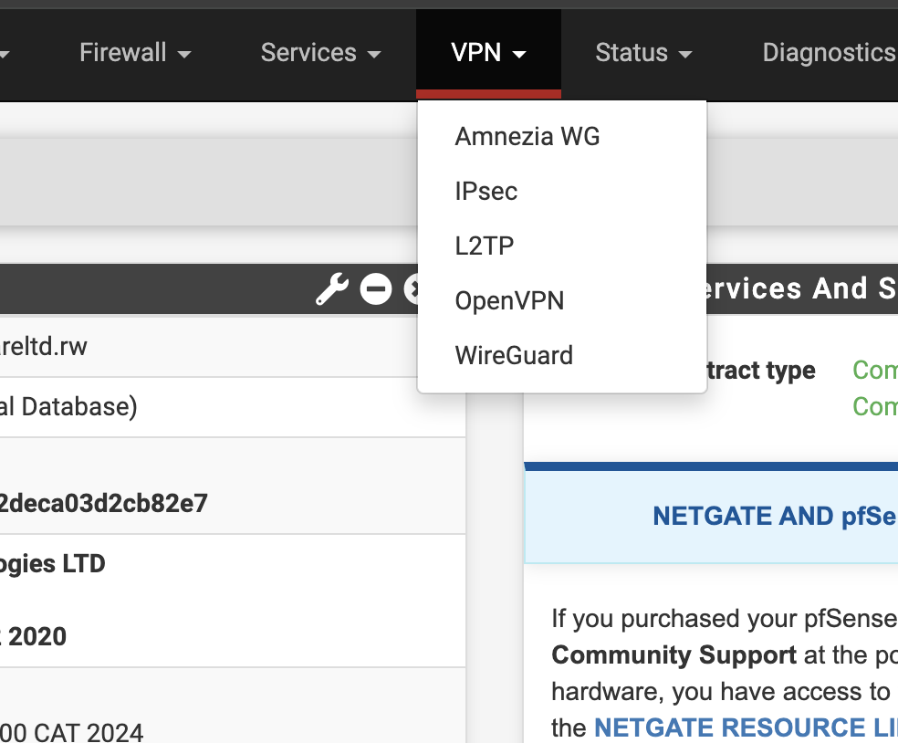
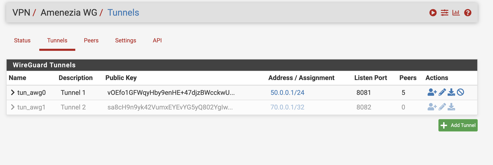
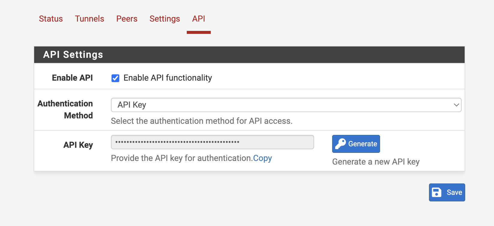

# AmneziaWG - Amnezia WireGuard Package for pfSense

AmneziaWG is a pfSense package that integrates the [Amnezia VPN](https://amnezia.org) stack, offering a simplified interface and automation for managing Amnezia WireGuard VPN tunnels directly within the pfSense UI.

---

## Overview

This project provides:
- Seamless installation of Amnezia-based WireGuard on pfSense
- Configuration UI for Amnezia WireGuard tunnels and peers
- Automatic tunnel configuration generation
- API for remote management (e.g., via MDM)

It is designed for teams or individuals deploying secure VPN services through pfSense, with a strong focus on simplicity and automation.

---


## pfSense Compatibility

| Version        | Status                     |
|----------------|----------------------------|
| pfSense 2.7.2  | ✅ Fully Tested             |
| pfSense Plus   | ⚠️ Untested (likely works) |

> 💡 Always use the latest stable version of pfSense for best compatibility and security.

---

## Installation

### Prerequisites

- A running pfSense instance
- Administrator access to the pfSense Web UI
- Internet connectivity on the pfSense box (for pulling updates)

### CLI Installation

1. Download the CI-produced artifact, e.g.:
   ```
   pfSense-pkg-Amneziawireguard-1.0.0.pkg
   ```

2. Copy the package to your pfSense box via SSH:
   ```bash
   scp pfSense-pkg-Amneziawireguard-1.0.0.pkg admin@<pfsense-ip>:/root/
   ```

3. SSH into pfSense and run:
   ```bash
   pkg add /root/pfSense-pkg-Amneziawireguard-1.0.0.pkg
   ```

4. Once installed, log into the pfSense Web UI to begin configuration.

---
## Setting pfSense Firewall Rules  

Follow these steps to configure pfSense firewall rules and NAT so that a Amnezia WireGuard VPN client can access the internet.

---

### 1. Allow AmneziaWG Traffic on the WAN Interface

- **Navigate:** `Firewall > Rules > WAN`
- **Add a new rule** with the following settings:
  - **Action:** Pass
  - **Interface:** WAN
  - **Protocol:** TCP/UDP
  - **Source:** any
  - **Destination:** WAN address
  - **Destination port:** 8081  (any but don't use 51820 because it is default WireGuard port)
  - **Description:** Allow Amnezia WG traffic
- **Save and apply changes.**

> This rule allows incoming Amnezia WireGuard connection requests to reach pfSense.

---

### 2. Allow Amnezia WireGuard Traffic on It's Interface

- **Navigate:** `Firewall > Rules > AmneziaWG` (the interface created after installing Amnezia Wireguard package)
- **Add a rule** to allow traffic from the Amnezia WireGuard subnet:
  - **Action:** Pass
  - **Protocol:** any
  - **Source:** AmneziaWG networks (e.g., 10.0.0.0/24)
  - **Destination:** any
  - **Description:** Allow Amnezia WG VPN traffic
- **Save and apply changes.**

> This enables VPN clients to send traffic through the Amnezia WG interface.

---

### 3. Configure Outbound NAT for the WireGuard Subnet

- **Navigate:** `Firewall > NAT > Outbound`
- **Change mode:** Hybrid Outbound NAT
- **Add a new mapping:**
  - **Interface:** WAN
  - **Source:** AmneziaWG networks (e.g., 10.0.0.0/24)
  - **Translation / target:** WAN address
- **Save and apply changes.**

> This NAT rule translates VPN client traffic so it can be routed to the internet via the WAN interface.

---

### 4. DNS Rule (If Clients Have No Internet Access)

If pings work but there is no internet access, ensure DNS is allowed:

- **Add a firewall rule** on the Amnezia WG interface:
  - **Action:** Pass
  - **Protocol:** UDP/TCP
  - **Source:** any
  - **Destination port:** 53
  - **Description:** Allow DNS traffic

> This allows DNS queries from VPN clients to pass through the firewall.

## Using the GUI

After installation, navigate to:

```
pfSense Web UI → VPN → AmneziaWG
```

Here you'll find tabs to manage Tunnels, Peers, and the API.

### Interface Preview

**Main Menu Entry:**



**Tunnel and Peer Management:**



**API Settings:**

- Enable the API by checking the box
- Generate an API key for authentication
- Refer to the full API documentation for usage details



Here is the [Link to the API Documentation](https://gitlab.qtsoftwareltd.com/qtphone/amneziawg/-/blob/main/API_Documentation.md) 


